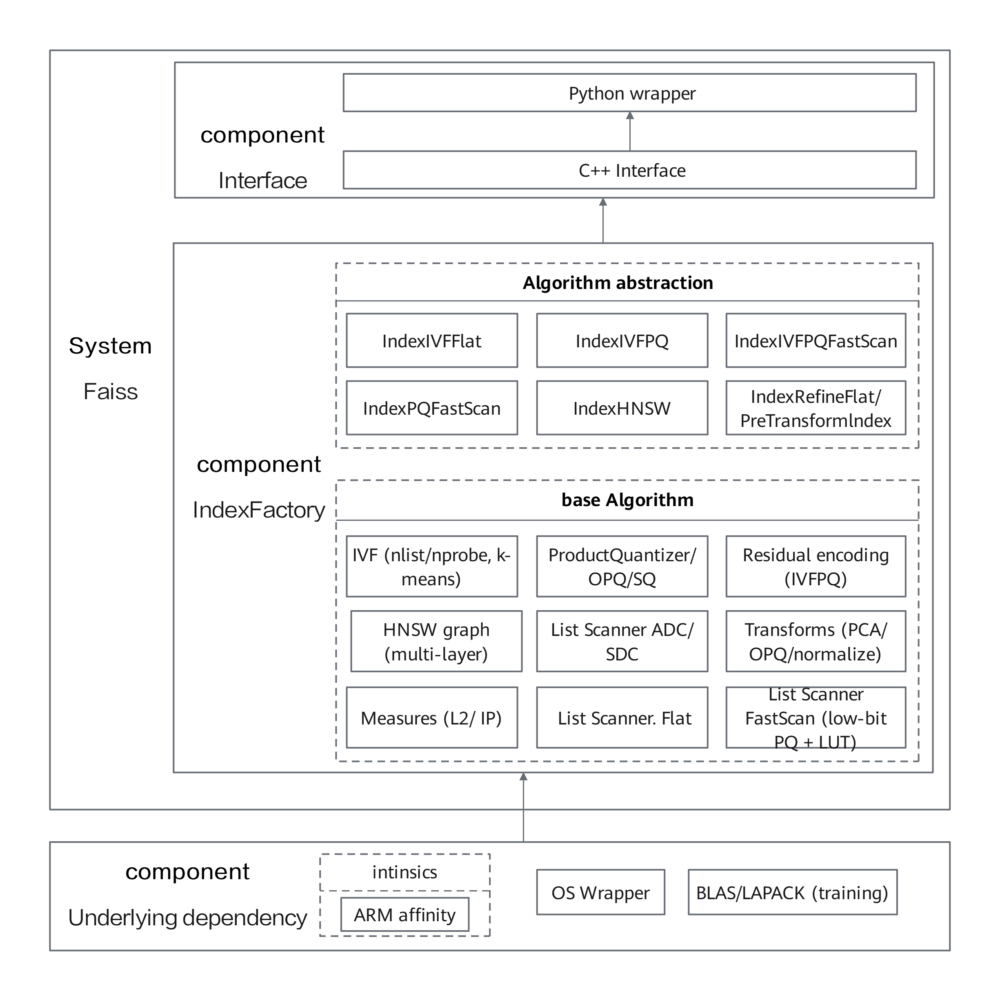

# Feature Introduction

<!-- md-trans-meta sourceCommit=c9b1501b6323556dfdb1efa80ea6654f1459b2ed translatedAt=2026-10-23T08:57:57.155Z pushedAt=2026-10-26T01:07:09.479Z -->

## Architecture

This document describes the logical structure of the main Faiss algorithms, as well as the definitions and functions of the modules.
The Faiss system consists of three major layers: the API layer, the index factory layer, and underlying dependencies. Built with a C++ core, it provides upper-tier invocations via a Python wrapper. The index factory layer consists of two sub-layers: algorithm abstraction and basic algorithms. The algorithm abstraction layer encapsulates multiple index types (HNSW, IVF, PQ, and their combinations), while the basic algorithm layer provides the underlying data structures and computational methods.

Core indexing capabilities:

- HNSW implements efficient approximate nearest neighbor (ANN) search via multi-layer navigable small-world graphs.
- IVF divides the vector space using K-means clustering to narrow down the search scope.
- PQ/SQ provides vector compression capabilities to significantly reduce memory footprint.
- FastScan leverages SIMD instructions to accelerate distance computations.
- Refine enables two-phase retrieval capabilities for coarse-grained ranking and fine-grained reranking.

While keeping the open-source Faiss APIs unchanged, extension APIs are added to enable FP16 functionality. The logical architecture and functional modules of Faiss are shown below.

**Figure 1** Faiss logical architecture

| Layer | Module | Function |
| ---- | ---- | ---- |
| API layer | C++ Interface | External interface for Faiss algorithms, through which the Python wrapper invokes the underlying implementations. |
| Index factory layer (algorithm abstraction) | IndexHNSW | An index implementation based on multi-layer navigable small-world graphs. It routes down rapidly layer by layer from the top during queries to balance search efficiency and recall rate. |
| Index factory layer (algorithm abstraction) | IndexIVFFlat | Inverted file index + Flat storage. It narrows down the candidate scope through IVF clustering first, and then performs exact distance computations on candidate vectors. |
| Index factory layer (algorithm abstraction) | IndexIVFPQ | Inverted file index + Product Quantization (PQ). It performs PQ compression on residual vectors after clustering, suitable for ultra-large-scale datasets. |
| Index factory layer (algorithm abstraction) | IndexPQFastScan / IndexIVFPQFastScan | SIMD-accelerated versions of PQ indexing. It implements fast distance computation using low-bit PQ and look-up table (LUT). |
| Index factory layer (algorithm abstraction) | IndexRefineFlat / PreTransformIndex | Two-stage retrieval: the first stage uses a coarse index to quickly filter candidate sets, and the second stage performs exact distance re-ranking with Flat; PreTransform supports PCA/OPQ preprocessing transformations. |
| Index factory layer (basic algorithms) | HNSW graph (multi-layer) | Implementation of the HNSW multi-layer graph structure. The upper layers are sparse for fast routing, and the lower layers are dense for precise search. |
| Index factory layer (basic algorithms) | IVF (nlist/nprobe, K-Means) | Basic algorithm of inverted files. It divides the vector space into nlist cells via K-means, and searches the nprobe nearest cells during queries. |
| Index factory layer (basic algorithms) | ProductQuantizer / OPQ / SQ | Vector compression techniques: PQ quantizes vectors by segment, OPQ is rotationally optimized PQ, and SQ is scalar quantization. |
| Index factory layer (basic algorithms) | Measures (L2 / IP) | Provides implementations for two distance metrics: L2 Euclidean distance and Inner Product (IP) distance. |
| Index factory layer (basic algorithms) | List Scanner (Flat / ADC / FastScan) | List scanner: Flat is used for exact computation, ADC is used for PQ asymmetric distance computation, and FastScan uses SIMD instructions for acceleration. |
| Index factory layer (basic algorithms) | Transforms (PCA/OPQ/normalize) | Vector preprocessing transformations, including PCA dimensionality reduction, OPQ, and vector normalization. |
| Underlying dependencies | intrinsics / ARM affinity | SIMD intrinsic wrappers and Kunpeng (Arm) affinity optimizations, providing hardware acceleration for hotspot operators such as distance computation. |
| Underlying dependencies | OS Wrapper | Wrappers of OS-related capabilities, such as memory allocation, threads, and timing. |
| Underlying dependencies | BLAS/LAPACK (training) | Basic linear algebra libraries (such as OpenBLAS), used for matrix operations in the training phase and batch distance computation. |

## Optimization Description

### v1.8.0

#### Non-Equivalence Optimization

| Optimization | Description |
| -------- | ----------- |
| LUT-based accumulation | The LUT accumulation operator is a critical hotspot operator in inverted index and exhaustive scan, often causing computational bottlenecks. Distance accumulation with sign extension requires additional registers, which reduces the degree of instruction unrolling and introduces redundant computational overhead. To address this, in-memory data layout is reordered to fully utilize the 256-bit wide registers. This approach minimizes temporary register overhead, increases the degree of instruction unrolling, and eliminates redundant computations (bit-width extension). By reducing the use of 16 registers, the pipeline utilization is improved, and the computation latency is reduced. |
| Vector filtering and compression | The filtering and compression process involves numerous intermediate steps when calculating bitmaps, creating a bottleneck. A large portion of the intermediate data is invalid, leading to less than 50% average utilization of register bit-width. This optimization leverages SVE predicates and the 256-bit register width feature to bypass intermediate steps. |
| Distance computation optimization | In distance computation, the query vector is repeatedly accessed, making the memory access latency a system bottleneck. By computing the distances between one query and multiple base vectors simultaneously, the read latency of the query vector is significantly reduced. |
| Progressive reranking | PQ phase: This is a vector compression method that can reduce memory usage. However, 4-bit quantization leads to a certain decline in precision. After PQ coarse filtering, reranking is required to recover the lost precision. During reranking, SQ8 is used for fast distance computation first, and then FP32 is used to accurately compute the top N closest distances, improving computation efficiency. |
| Memory data rearrangement | In distance computation, the memory access to base vectors is non-contiguous. Cache miss causes memory access to become a system bottleneck. The data layout is adjusted to enable streaming memory access, cooperating with prefetching to reduce cache misses and memory access latency. |

#### IVFPQ Optimization

| Optimization | Description|
|--------|-----------|
| LUT-based accumulation | The LUT accumulation operator is a critical hotspot operator in inverted index and exhaustive scan, often causing computational bottlenecks. Distance accumulation with sign extension requires additional registers, which reduces the degree of instruction unrolling and introduces redundant computational overhead. To address this, in-memory data layout is reordered to fully utilize the 256-bit wide registers. This approach minimizes temporary register overhead, increases the degree of instruction unrolling, and eliminates redundant computations. Hand-coded assembly is leveraged to implement multi-code parallelism and batch unrolling of multiple subquantizers, further reducing loop and address update overhead. For the random access feature of the PQ table, manual instruction scheduling and software prefetching are performed to maximize memory-level parallelism and reduce calculation latency.|
| Vector multiply-accumulate optimization | Vector multiply-accumulate is the core operator for distance computation. When data alignment conditions are met, the optimization path is enabled: increasing the data volume processed per iteration, and optimizing load/compute/store pipeline orchestration to shorten the instruction dependency chain. A non-temporal write policy is adopted to reduce cache pollution and improve write bandwidth efficiency.|

#### HNSW FP16 Support

| Optimization | Description|
|--------|-----------|
| HNSW FP16 Interface support | The FP16 data type reduces the storage space of each vector component from 4 bytes in FP32 to 2 bytes. This significantly reduces the memory space required for building HNSW indexes, allowing for the processing of larger vector datasets under limited hardware resources. In addition, optimized for the Kunpeng Arm architecture, the FP16 distance computation algorithm improves the efficiency of node distance comparison during graph retrieval, reducing memory footprint.|

### v1.14.3

#### IVFRaBitQFS Optimization

| Optimization | Description |
| -------- | ----------- |
| Binary code LUT-based acceleration | The 1-bit code inner product calculation of RaBitQ requires bit-by-bit extraction of rotated query components and accumulation, performing d bitwise tests per database vector, causing loop overhead that grows linearly with dimensionality. The KRL path precomputes the rotated query into per-byte high/low nibble lookup tables, and combines them with a 256-entry bit-counting table, converting the bit-by-bit inner product into two table lookups and accumulations per byte, thereby eliminating per-bit branches and the need for loop unrolling. |
| LUT-based parallel construction | RaBitQ's lookup table construction comprises three steps: subset-sum writes, residual type conversion with multiply-add, and range normalization combined with type conversion quantization, all performed as scalar loops. The KRL path merges multiple scattered subset-sum writes into a few vectorized store operations, and uses vectorized parallelism for both residual conversion and normalization quantization, thereby shortening the instruction dependency chain. |
| Heap operation batch processing | Heap operations occur frequently in the RaBitQ search path. The KRL path replaces the standard heap implementation with a custom heap, performs distance correction and heap insertions in parallel batches using vectorized operations, and leverages software prefetching to load subsequent code block data in advance, thereby reducing heap maintenance overhead and cache misses. |
| Code layout rearrangement | RaBitQ processes distance calculations in batches of multiple vectors, but the default code layout is not aligned with batch-wise processing. The KRL path rearranges code blocks during index loading to achieve memory access alignment. Under batch queries, it also pre-allocates buffers (e.g., lookup tables) per thread and reuses them across inverted-list iterations, eliminating repetitive per-iteration memory allocations. |

## Change History

| Version | Date | Description |
| --- | --- | --- |
| 01 | 2026-09-30 | This is the first official release. |
