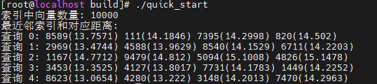
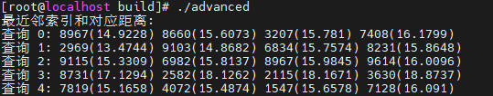

# Quick Start

<!-- md-trans-meta sourceCommit=1bff20118dfa17d1bdd1a6bef30e25a96681758a translatedAt=2026-11-10T08:58:34.403Z pushedAt=2026-11-11T01:07:09.484Z -->

This document provides straightforward guidance for quickly getting started with Faiss core features.

## Core Concepts

The core of Faiss is the index, a structure specifically designed to store vectors and efficiently perform similarity searches.

- Vectors: Open-source Faiss supports float32 vectors.
- Index types: For beginners, IndexFlatL2 (an exhaustive search index that yields exact results with no approximation, making it ideal for learning) is recommended. You can try IndexIVFFlat (an approximate search index for faster speed) later.
- Core workflow: Create an index → Add vectors to the index → Execute similarity search.

## Example

The following example demonstrates the core usage scenarios of Faiss, with inline comments and result parsing.

```cpp
#include <faiss/IndexFlat.h>
#include <iostream>
#include <vector>
#include <random>

int main() {
    // 1. Prepare data.
    int d = 128;
    int nb = 10000;
    int nq = 5;

    std::vector<float> db_vectors(nb * d);
    std::vector<float> query_vectors(nq * d);

    std::mt19937 rng(42);
    std::uniform_real_distribution<float> dist(0.0f, 1.0f);
    for (auto& v : db_vectors) v = dist(rng);
    for (auto& v : query_vectors) v = dist(rng);

    // 2. Create an index (IndexFlatL2: exhaustive search based on L2 distance).
    faiss::IndexFlatL2 index(d);

    // 3. Add vectors to the index.
    index.add(nb, db_vectors.data());
    std::cout << "Number of vectors in the index: " << index.ntotal << std::endl;

    // 4. Perform the search.
    int k = 4;
    std::vector<float> distances(nq * k);
    std::vector<faiss::idx_t> indices(nq * k);

    index.search(nq, query_vectors.data(), k, distances.data(), indices.data());

    // 5. Parse the results.
    std::cout << "Nearest neighbor indices and distances: " << std::endl;
    for (int i = 0; i < nq; i++) {
        std::cout << "Query " << i << ": ";
        for (int j = 0; j < k; j++) {
            std::cout << indices[i * k + j] << "(" << distances[i * k + j] << ") ";
        }
        std::cout << std::endl;
    }

    return 0;
}
```

The expected output is as follows.



## Advanced Extension

IndexIVFFlat: suitable for large datasets. The core mechanism is to cluster data before searching.
`nlist` is the number of clusters formed during training (int; 100 in this example; it must be smaller than the number of training vectors; a larger value yields higher recall but increases training and memory overhead). `nprobe` is the number of clusters probed during query (int; 10 in this example; ranging from 1 to `nlist`; a larger value makes the results closer to exact search but increases query latency).

```cpp
#include <faiss/IndexFlat.h>
#include <faiss/IndexIVFFlat.h>
#include <iostream>
#include <vector>
#include <random>

int main() {
    int d = 128;
    int nb = 10000;
    int nq = 5;
    int nlist = 100;

    std::vector<float> db_vectors(nb * d);
    std::vector<float> query_vectors(nq * d);

    std::mt19937 rng(42);
    std::uniform_real_distribution<float> dist(0.0f, 1.0f);
    for (auto& v : db_vectors) v = dist(rng);
    for (auto& v : query_vectors) v = dist(rng);

    // Create a quantizer and an IVF index.
    faiss::IndexFlatL2 quantizer(d);
    faiss::IndexIVFFlat ivf_index(&quantizer, d, nlist);
    ivf_index.nprobe = 10;

    ivf_index.train(nb, db_vectors.data());
    ivf_index.add(nb, db_vectors.data());

    // Perform the search.
    int k = 4;
    std::vector<float> distances(nq * k);
    std::vector<faiss::idx_t> indices(nq * k);
    ivf_index.search(nq, query_vectors.data(), k, distances.data(), indices.data());

    // Parse the results.
    std::cout << "Nearest neighbor indices and distances: " << std::endl;
    for (int i = 0; i < nq; i++) {
        std::cout << "Query " << i << ": ";
        for (int j = 0; j < k; j++) {
            std::cout << indices[i * k + j] << "(" << distances[i * k + j] << ") ";
        }
        std::cout << std::endl;
    }

    return 0;
}
```

The expected output is as follows.



## Change History

| Version | Date | Description |
| --- | --- | --- |
| 01 | 2026-09-30 | This is the first official release. |
